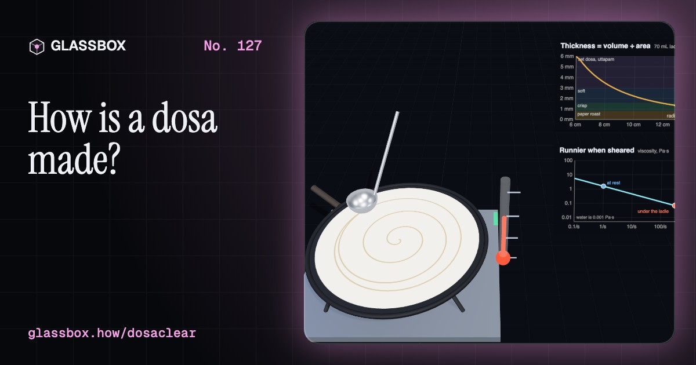
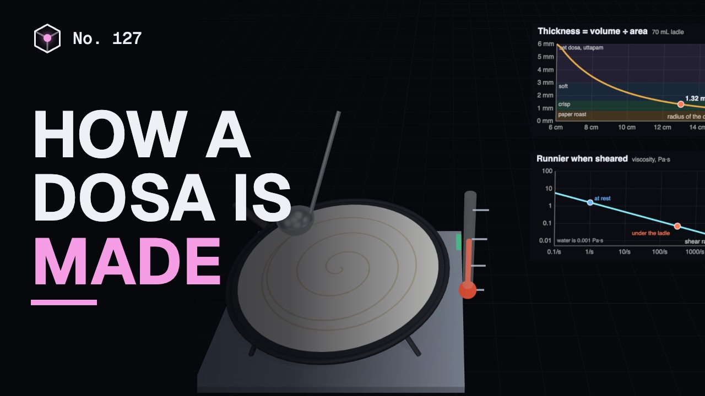
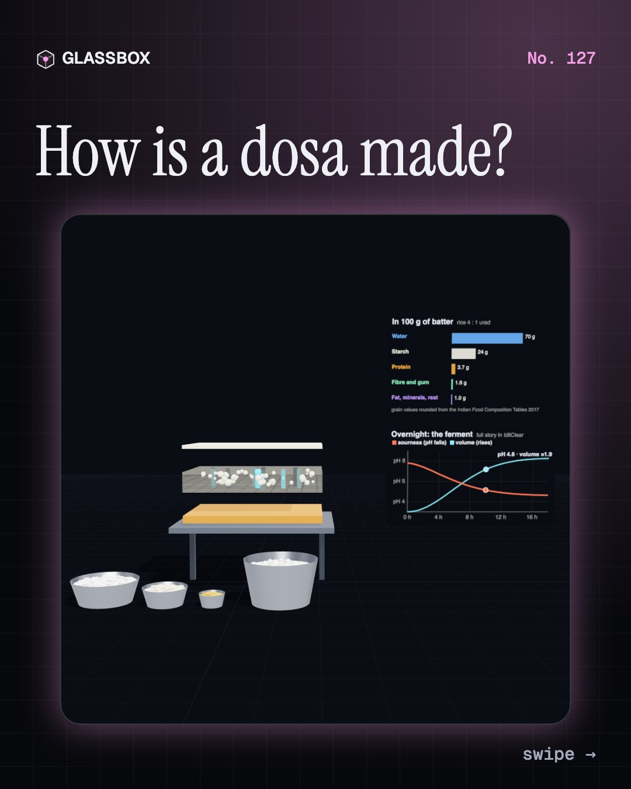
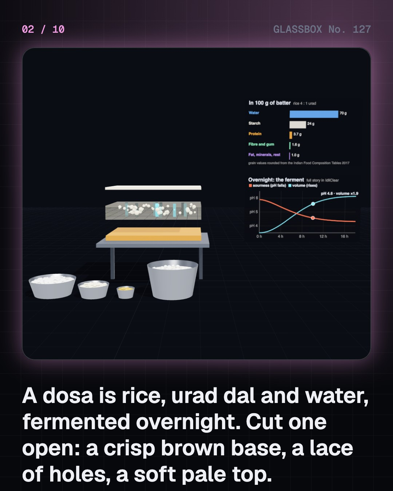
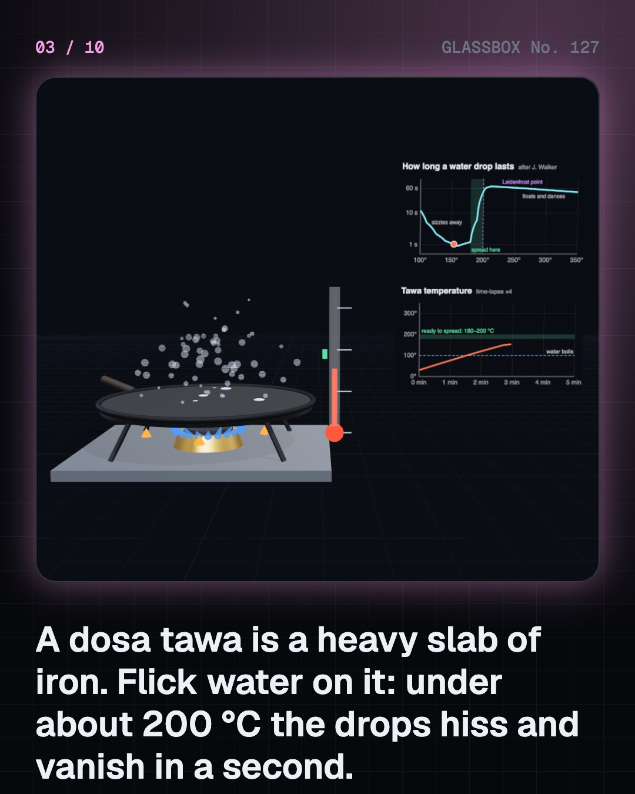
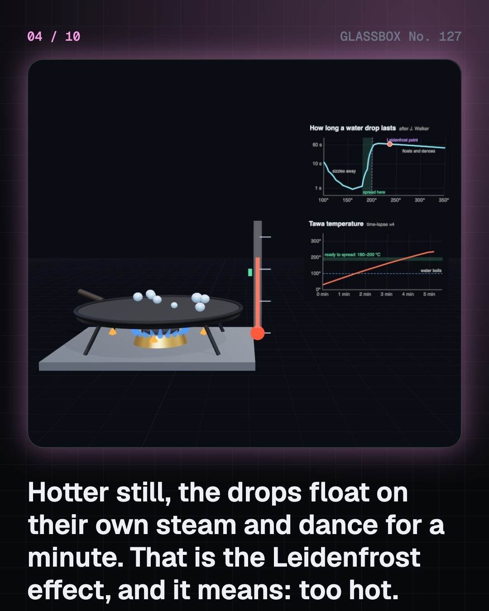

<!-- glassbox:start -->
<!-- Generated from glassbox.json by the Glassbox hub (npm run readme -- dosaclear). Edit glassbox.json, not this block. -->
<p align="center"><a href="https://glassbox.how/e/dosaclear/"></a></p>

<h1 align="center">DosaClear</h1>

<p align="center"><b>How is a dosa made?</b><br>A dosa is one ladle of sour batter turned into a crisp golden sheet in ninety seconds. Flick water on the tawa and watch the drops dance, walk the ladle out in a spiral to a film one millimetre thick, then cook it yourself: steam out through the lace, a crust climbing from the iron, and browning that cannot start until the base is dry.</p>

<p align="center"><a href="https://glassbox.how/dosaclear/"><b>▶ Play with it</b></a> &nbsp;·&nbsp; <a href="https://glassbox.how/e/dosaclear/">Read the 60-second explainer</a> &nbsp;·&nbsp; <a href="https://glassbox.how/dosaclear/glassbox/reel.mp4">Watch the 40-second video</a></p>

<p align="center">
  <a href="https://glassbox.how/e/dosaclear/"></a>
  <a href="https://glassbox.how/e/dosaclear/"></a>
  <a href="LICENSE"></a>
  <a href="LICENSE-CONTENT.md"></a>
  <a href="#privacy"></a>
</p>

## In 60 seconds

1. **Batter, a crisp side and a soft side.** Dosa batter is rice and urad dal ground wet, thinned to about 70% water and fermented overnight by wild lactic acid bacteria, which sour it and fill it with gas. Cooked from one side only, it becomes a sheet with a dry, brown, crisp base, a lace of holes and a pale, soft top.
2. **The tawa and the dancing drops.** A 3 kg cast-iron tawa stores about 1.4 kJ for every degree, so cold batter does not chill it. Cooks test it with water: at roughly 180 to 200 °C drops hiss and vanish in a second; hotter than that they float on their own steam and dance for up to a minute. That is the Leidenfrost effect, and it means too hot: wipe it with a wet cloth or a cut onion.
3. **One ladle, one spiral.** Thickness is volume divided by area: 70 mL spread to a 13 cm radius is a film 1.3 mm thick. Batter is shear-thinning, so it turns many times runnier under the moving ladle and thickens again when the ladle lifts. The bottom starts to set the moment it touches the iron, so the spiral has to be quick.
4. **Steam out, crust up, colour in.** While any batter is wet it is pinned at 100 °C, because the heat goes into steam (2,257 J per gram) that escapes through the holes. A dry crust grows up from the iron; only then can the base pass about 140 °C and brown by the Maillard reaction. Ferment, a pinch of sugar or chana dal, and a film of oil all help the colour.
5. **Why the first fails and the last goes soft.** Wet batter glues itself into the pores of bare iron. Seasoning, a film of oil polymerised onto the metal, and an evenly hot surface stop that, which is why the second dosa lifts clean. On the plate, crisp starch glass soaks up the dosa's own trapped steam and turns leathery in minutes, so a paper roast is rolled and stood up.
6. **A family, not one dish.** Spread the same batter to half a millimetre and it is a paper roast; pour it thick and it is a set dosa or an uttapam. Change the batter and you get rava dosa, neer dosa, pesarattu, adai or ragi dosa. Thin films dry through and go crisp; thick ones stay soft.

## Words worth knowing

| Term | Meaning |
|---|---|
| **Tawa** | A flat, heavy griddle. A 30 cm cast-iron dosa tawa weighs about 3 kg and stores about 1.4 kJ of heat per degree. |
| **Leidenfrost effect** | On a surface far hotter than its boiling point, a liquid drop floats on a cushion of its own vapour and evaporates slowly. For water on metal it starts at about 200 °C. |
| **Film thickness** | The volume of batter divided by the area it covers. One 70 mL ladle spread to a 13 cm radius is 1.3 mm thick. |
| **Shear-thinning** | A fluid that gets runnier the faster it is sheared. Dosa batter does it, which is why it spreads easily under the ladle and then stays put. |
| **Gelatinisation** | Starch granules swelling and setting when heated in water to about 60 to 75 °C. It turns liquid batter into a sheet. |
| **Maillard reaction** | The reaction between sugars and amino acids that makes brown colour and roasted aromas. It runs fast from about 140 °C, so it needs a dry surface. |
| **Glassy state** | Dry starch that is hard and brittle, like glass. That is crispness. When it takes up water it turns leathery. |
| **Seasoning** | A hard, slick film of polymerised oil baked onto cast iron. It keeps wet batter from gripping the metal. |
| **Lace** | The network of small holes in a dosa, left by the ferment's gas bubbles and by steam escaping. |

## A short history

**From a word in old Tamil poems to a 37-metre record: how a fermented pancake became India's crisp golden sheet.**

- **100** · Dosai in the old Tamil country? (Poets of the Sangam age, as read by K. T. Achaya, Tamilakam, south India)
- **1129** · A king writes down dosaka (Someshvara III, Western Chalukya king, Kalyani, present-day Karnataka)
- **1756** · Leidenfrost and the red-hot spoon (Johann Gottlob Leidenfrost, Duisburg)
- **1912** · Why food browns (Louis-Camille Maillard, Paris)
- **1924** · Brahmin Coffee Club, later MTR (Parampalli Yagnanarayana Maiya and his brothers, Bengaluru, Karnataka)
- **1926** · Krishna Rao opens on Mount Road (Kadandale Krishna Rao, Madras (Chennai), Tamil Nadu)
- **1935** · The masala dosa (Credited to Kadandale Krishna Rao, Madras (Chennai), Tamil Nadu)
- **1955** · The wet grinder (P. Sabapathy, Coimbatore, Tamil Nadu)

The full story, with 30 moments, charts, people and 28 sources: [glassbox.how/e/dosaclear/history](https://glassbox.how/e/dosaclear/history/). The data lives in [`history.json`](history.json).

## Video and slides

Made with the Glassbox studio from this box's storyboard (`window.glassbox.director`). Free to reuse under CC BY 4.0.

<a href="https://glassbox.how/dosaclear/glassbox/video.mp4"></a>

<p><a href="glassbox/slide-1.jpg"></a> <a href="glassbox/slide-2.jpg"></a> <a href="glassbox/slide-3.jpg"></a> <a href="glassbox/slide-4.jpg"></a></p>

| File | What | Size |
|---|---|---|
| [`glassbox/reel.mp4`](https://glassbox.how/dosaclear/glassbox/reel.mp4) | Reel / Short, with captions and soundtrack | 1080×1920 |
| [`glassbox/video.mp4`](https://glassbox.how/dosaclear/glassbox/video.mp4) | YouTube video, with captions and soundtrack | 1920×1080 |
| `glassbox/slide-1…10.jpg` | Instagram carousel | 1080×1350 |
| `glassbox/thumb.jpg` | YouTube thumbnail | 1280×720 |
| `glassbox/cover.jpg` | Share card and repo social preview | 1200×630 |
| [`glassbox/history-reel.mp4`](https://glassbox.how/dosaclear/glassbox/history-reel.mp4) | “History in 10 moments” Reel / Short | 1080×1920 |
| `glassbox/history-slide-*.jpg` | History carousel | 1080×1350 |
| `glassbox/post.json` | Post copy and schedule used by the publish kit | |

## Privacy

This box has no accounts and no ads, and it ships its own fonts and libraries. When you run it yourself it sends nothing anywhere. On glassbox.how, the site's `/bar.js` also loads Glassbox's analytics: **Google Analytics** to count visits (it asks first in the EU, UK and Switzerland, and stays off when your browser sends Global Privacy Control or Do Not Track) and **ClickTrust** to detect bots.

It remembers a few things **in your own browser only**, and never sends them anywhere:

| Browser storage key | What it holds |
|---|---|
| `dosaclear.v1` | Which chapters you have opened, your best quiz scores, and sound on or off. |

Exactly what each one sees is at [glassbox.how/privacy](https://glassbox.how/privacy/).

## Licences

- **Code:** [MIT](LICENSE). Use it, change it, ship it.
- **Explanations, text, images and videos** (`glassbox.json`, `glassbox/`): [CC BY 4.0](LICENSE-CONTENT.md). Credit “Glassbox, glassbox.how/e/dosaclear”.
- **Third-party parts** keep their own licences: [three.js](https://threejs.org) (MIT), [Geist, Instrument Serif](https://openfontlicense.org) (SIL OFL 1.1).
- The Glassbox name and logo aren't covered by either licence. See the [terms](https://glassbox.how/terms/).

Found a mistake? [Open an issue](https://github.com/bdeeps/dosaclear/issues). Corrections happen in public.
<!-- glassbox:end -->

## Run it

It's plain HTML, CSS and JavaScript. No build step and no dependencies. Run locally, it contacts no other website.

```bash
python3 -m http.server 8000
```

Three.js and the fonts ship in `vendor/` and `fonts/`, so it also works offline.

Then open http://localhost:8000.

## How it's built

| File | What |
|---|---|
| `index.html`, `css/app.css` | The page and its styles |
| `js/app.js`, `js/stage.js`, `js/ui.js`, `js/kit.js` | The shared Glassbox 3D engine: chapters, 3D stage, controls, quiz, video director |
| `js/chapters/*.js` | One file per chapter: the 3D model, controls, text, key terms, quiz and video scenes |
| `js/model.js` | The numbers: batter, tawa heat balance, water-drop lifetimes, the spiral, the cooking and softening models, the dosa family |
| `js/dosa.js` | Shared 3D parts and chart helpers: the tawa on its stove, the thermometer, the painted dosa, chart boards, steam |
| `glassbox.json` | Title, question, explainer beats, key terms, browser storage and credits shown on glassbox.how |
| `reel` in each chapter | The storyboard the Glassbox studio records into short videos |
| `glassbox/` | The published video, slides, thumbnail and post copy |
| `fonts/`, `vendor/three/` | Self-hosted Geist and Instrument Serif (SIL OFL 1.1) and three.js (MIT) |
